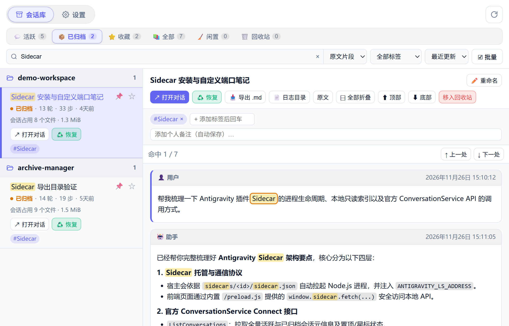

# Session Manager (`archive-manager`)

[简体中文](README.md)

A session manager plugin (Sidecar + Skill) for Google Antigravity. Browse, archive, restore, preview, and export your conversations.

## Screenshots

**Main Workspace & Auto-Collapsed Long Replies (Active View · Amber Archive Buttons)**


**Archived View, Full-Text Search Highlighting & Expanded Markdown Preview (Green One-Click Restore)**



## Key Features

- **5-Tab Categorized Views**: Switch seamlessly across **Archived**, **Active**, **Starred**, **Stale**, and **All** conversations with live counts.
- **Full-Text Search & Multi-Dimensional Filters**: Search across titles, project names, message bodies (via read-only FTS index), custom tags, and personal notes; filter by project or tag and sort by last updated, step count, or title.
- **Archive and Restore with Undo**. Use the green **Restore** and amber **Archive** buttons to change a conversation's state in place. Select multiple conversations or archive stale conversations after 3, 7, 14, or 30 days.
- **Preview Without Restoring**
  - Prefers `transcript_full.jsonl` and uses `transcript.jsonl` where applicable. If neither transcript provides usable content, the panel can fall back to FTS excerpts. A preview may contain only partial messages or summaries when history is missing.
  - Smooth independent scrolling, automatic collapsing with a fade overlay for long replies (> 450px) and an **Expand / Collapse** toggle, plus toolbar shortcuts for **Expand All / Collapse All**, **Top**, **Bottom**, and **Markdown / Raw** view.
- **Inline Organization & Safe Deletion**: Rename conversations inline, pin (📌) or star (★) directly from list cards, attach custom `#tags` and auto-saved personal notes (stored cleanly in Sidecar data dir), and safely block/confirm deletion of running conversations.
- **Markdown Export**. Save available conversation content, metadata, tags, and notes to `~/Documents/Antigravity-Exports`. Open the export folder or reveal the saved file from the panel.
- **Optional Left-Sidebar Quick Entry**. With CDP enabled, the left sidebar shows a **Session Manager** button and the archived count. The side-panel Plugins menu and skill prompts also open the panel.

## What's new in v2.2.0

- Use the **简体中文 / English** menu at the top of the panel to change languages. The browser language determines whether the panel opens in Chinese or English the first time. The plugin remembers your choice.
- The selected language applies to panel controls, confirmations, errors, concise left-sidebar labels, and labels in Markdown exports, while timestamps follow your local timezone. Conversation text, titles, tags, and notes stay in their original language.
- Universal host theme & UI pack compatibility: dynamic `color-mix` accent/surface tokens, inherited host fonts, dark/light-safe code blocks & toasts, and hardened left-sidebar tab matching across custom layouts.

## What's new in v2.1.1

- When conversations or filters change quickly, older responses no longer overwrite the current preview or list.
- Undo is available for successful changes in a batch. The panel reports partial failures.
- Before archiving stale conversations in bulk, the backend checks their current state and skips conversations that are archived, starred, pinned, running, or below the selected inactivity threshold.
- Permanent deletion requires an explicit idle state. Tags and notes are saved atomically, and unreadable metadata files are preserved.
- Markdown exports record the content source and include warnings where appropriate. Each export creates a separate file.
- The optional sidebar only reads the archive count after finding a usable debugging page. Archive changes refresh the badge.

## Installation

### Option 1: Install Scripts (Recommended)

**Windows (PowerShell):**

```powershell
git clone https://github.com/YukiKaguraA/agy-archive-manager.git
cd agy-archive-manager
.\scripts\install.ps1
```

**macOS / Linux:**

```bash
git clone https://github.com/YukiKaguraA/agy-archive-manager.git
cd agy-archive-manager
chmod +x scripts/install.sh
./scripts/install.sh
```

### Option 2: Manual Installation

Copy the plugin payload into `~/.gemini/config/plugins/archive-manager/` (`%USERPROFILE%\.gemini\config\plugins\archive-manager\` on Windows):

- `plugin.json`
- `logo.svg`
- `README.md`
- `README.en.md`
- `docs/screenshots/` (images used in the READMEs)
- `LICENSE`
- `skills/`
- `sidecars/`

Then enable **Session Manager (`archive-manager`)** in Antigravity under **Customizations → Plugins**.

## Requirements

- **Google Antigravity**. The plugin targets Antigravity 2.35.0 and uses publicly documented Sidecar support for the panel and process lifecycle. See the [Antigravity Sidecar documentation](https://antigravity.google/docs/sidecars/).
- **Conversation data**. The plugin uses Antigravity's internal `ConversationService` for session operations, a read-only SQLite summary index, and transcript files. Antigravity updates can change these interfaces and data formats.
- **Node.js**. The Sidecar command is `node`. The Node.js runtime that Antigravity launches must enable `node:sqlite` by default. Examples include Node.js 22.13+ on the 22.x LTS line and Node.js 24 LTS. See the [Node.js SQLite documentation](https://nodejs.org/api/sqlite.html).
- **Left-sidebar quick entry (optional)**. The quick-entry button and badge depend on Antigravity's UI and Chrome DevTools Protocol (CDP). Start Antigravity with `--remote-debugging-port=0` to use them.

## Local regression tests

The test harness requires Node.js 22.15+ on the 22.x LTS line or Node.js 24 LTS. Run from the repository root.

```sh
node --test
```

The tests use mock Antigravity services and temporary conversation data.

## License

Licensed under the [MIT License](LICENSE).
