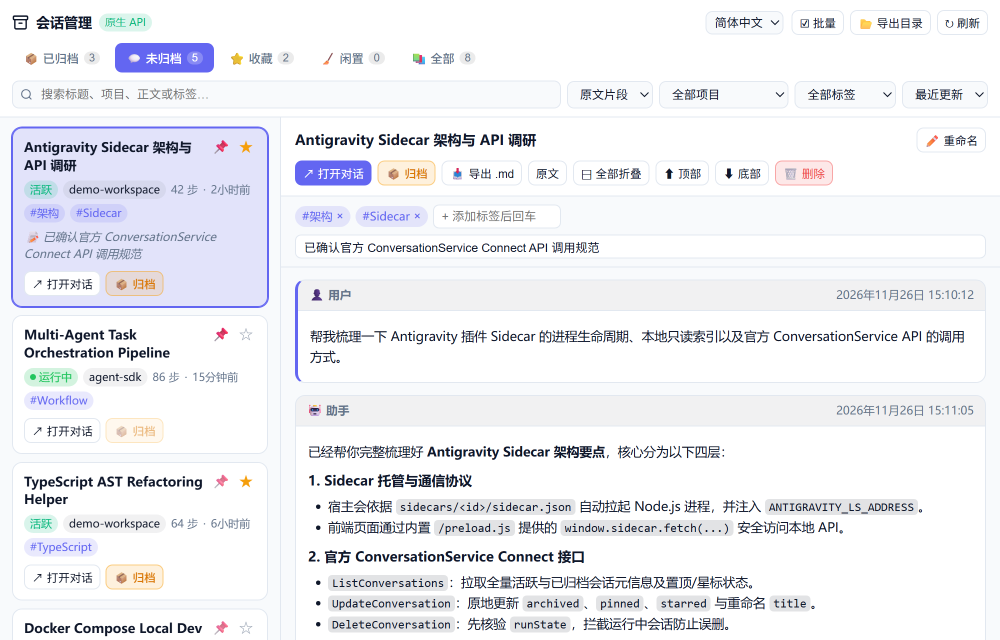
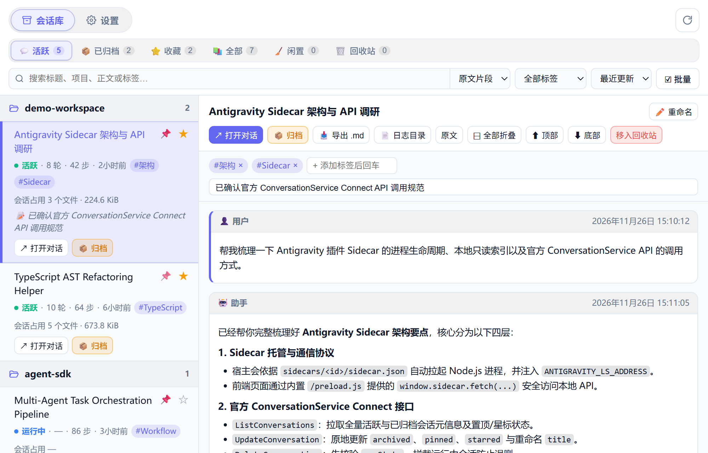

<div align="center">


# Session Manager · 会话管理

**Archive, search, preview, and export your Google Antigravity conversations**

Five views · Full-text search · Preview without restoring · Batch archive with undo · Tags & notes · Markdown export · English & 简体中文

[**简体中文**](./README.md) · [**English**](./README.en.md) · [**Changelog**](./CHANGELOG.md) · [**Releases**](https://github.com/YukiKaguraA/agy-archive-manager/releases) · [**Issues**](https://github.com/YukiKaguraA/agy-archive-manager/issues)

<p>
  <a href="https://github.com/YukiKaguraA/agy-archive-manager/releases"></a>
  
  
  
  
  <a href="./LICENSE"></a>
</p>

<picture>
  <source media="(prefers-color-scheme: dark)" srcset="docs/screenshots/hero-dark.png" />
  <source media="(prefers-color-scheme: light)" srcset="docs/screenshots/hero-light.png" />
  
</picture>

<sub>Rendered from this repository's panel source by <code>tools/render-hero.mjs</code>. The light and dark versions follow your GitHub theme. All conversations shown are fictional.</sub>

</div>

> **Non-Affiliation Disclaimer**
>
> This is an independent open-source community plugin. It is not affiliated with, sponsored by, or endorsed by Google LLC. “Antigravity” and “Google” are mentioned only to describe compatibility.

---

## ✨ Highlights

- **Five views at a glance**: Archived, Active, Starred, Idle, and All, each with a live count.
- **Find anything**: Search titles, projects, message bodies, tags, and notes at once, with highlighted matches.
- **Read without restoring**: Preview past conversations directly. Long replies collapse automatically, and you can switch between formatted and raw views.
- **Changed your mind? Undo**: Archive or restore in batches, archive idle conversations by days inactive, and undo the result.
- **Stay organized**: Pin 📌, star ★, add `#tags`, keep auto-saved notes, and rename inline.
- **One-click Markdown export**: Export conversations with their metadata, tags, and notes to `~/Documents/Antigravity-Exports`.
- **Bilingual and theme-aware**: Switch the panel language at any time. Colors follow your host theme and UI packs.
- **Safe by default**: Running conversations cannot be deleted, SQLite is opened read-only, and local notes are saved atomically.

---

## 🖼️ Screenshots

### 1. Main panel and long-reply collapsing

In the Active view, the amber **Archive** button is always within reach. Replies taller than 450px collapse with a fade overlay and an **Expand / Collapse** toggle.

<p align="center">
  
</p>

### 2. Archived view and search highlighting

Search inside the Archived view to see highlighted matches, expand the Markdown preview, and use the green **Restore** button to bring a conversation back.

<p align="center">
  
</p>

### 3. Feature cheat sheet

| Task | Action | Where |
| :--- | :--- | :--- |
| Find an old conversation | Exact text or Keywords search, filter by project / group / tag, and sort | Top of the panel |
| Archive / restore | Amber **Archive** / green **Restore**, with undo | Cards, preview toolbar |
| Work in bulk | Select chats to archive or restore. Archived chats can also be permanently deleted after confirmation | **Batch** button |
| Clean up idle conversations | Archive conversations idle for 3 / 7 / 14 / 30 days | Idle view |
| Read long conversations | Expand All / Collapse All, ⬆ Top, ⬇ Bottom, Formatted / Raw | Preview toolbar |
| Organize | Pin, star, rename, `#tags`, notes | Cards and preview |
| Export | Save as `.md`, reveal the file, or open the export folder | Preview toolbar, **📂 Exports** |
| Open the panel | Left-sidebar entry (CDP) / Plugins menu / chat prompt | Several places |

---

## 🚀 Quick Start

### Option 1: Install scripts (recommended for most users)

**Windows (PowerShell):**

```powershell
git clone https://github.com/YukiKaguraA/agy-archive-manager.git
cd agy-archive-manager
.\scripts\install.ps1
```

**macOS / Linux:**

```bash
git clone https://github.com/YukiKaguraA/agy-archive-manager.git
cd agy-archive-manager
chmod +x scripts/install.sh
./scripts/install.sh
```

Run the same script again to update to the latest version in your clone.

### Option 2: Manual copy (developers / offline)

Copy these files into `~/.gemini/config/plugins/archive-manager/` (`%USERPROFILE%\.gemini\config\plugins\archive-manager\` on Windows):

- `plugin.json`, `logo.svg`, `LICENSE`
- `README.md`, `README.en.md`, `CHANGELOG.md`
- `docs/screenshots/` (images used in the READMEs)
- `skills/`, `sidecars/`

Then enable **Session Manager (`archive-manager`)** under **Customizations → Plugins**. Open it from the side panel, or ask the agent to “Open Session Manager”.

### Installing with an AI assistant

If you use Antigravity Agent, Claude Code, Cursor, or another AI assistant, ask it to run:

```bash
git clone https://github.com/YukiKaguraA/agy-archive-manager.git
cd agy-archive-manager

# 1. Run the install script for your OS (.\scripts\install.ps1 on Windows)
./scripts/install.sh

# 2. Check that the Sidecar runtime supports node:sqlite (should print "function")
node -e "import('node:sqlite').then(m => console.log(typeof m.DatabaseSync))"
```

Then remind the user to enable the plugin under **Customizations → Plugins**.

---

## 🆕 What's New in v2.3.0

- The list displays 50 conversations per page. Opening one shows all available transcript messages for that conversation.
- Choose **Exact text** for literal fragments or **Keywords** to combine terms across messages. Project, native group, and tag filters work together. Projects with the same name appear separately.
- In **Archived → Batch**, select chats across pages and choose **Delete selected permanently**. Review the list before confirming. The results identify deleted, skipped, and failed chats. Permanent deletion cannot be undone.
- If saved local tags differ from the host, the preview shows both sets. Use the host tags or sync the local set to the host. Notes stay local. Antigravity 2.35.2 can ignore a request to clear the last tag. The panel verifies the host response and retains the local record if the change did not take effect.

👉 [Read the full changelog](./CHANGELOG.md)

---

## ❓ FAQ

<details>
<summary><strong>The Session Manager entry does not appear in the left sidebar.</strong></summary>

The left-sidebar entry and archive badge rely on the Chrome DevTools Protocol (CDP). Start Antigravity with `--remote-debugging-port=0`. Without it, you can still open the panel from the Plugins menu or with a chat prompt.

</details>

<details>
<summary><strong>The panel does not open, or I see a <code>node:sqlite</code> error.</strong></summary>

The Sidecar starts with the `node` command, and that Node.js runtime must enable `node:sqlite` by default, for example Node.js 22.13+ (22.x LTS) or Node.js 24 LTS. Use the check command in “Installing with an AI assistant” above.

</details>

<details>
<summary><strong>The preview only shows some of the messages.</strong></summary>

The preview prefers `transcript_full.jsonl`, uses `transcript.jsonl` where applicable, and falls back to FTS excerpts when neither is available. Older conversations without full transcripts may show only partial messages or summaries, and the panel tells you when this happens.

</details>

<details>
<summary><strong>Something broke after an Antigravity update.</strong></summary>

Archive operations use Antigravity's internal `ConversationService`, and search and preview read internal data files, so host updates can change these interfaces. Please open an [issue](https://github.com/YukiKaguraA/agy-archive-manager/issues) with your Antigravity version.

</details>

<details>
<summary><strong>Where are exports, tags, and notes stored?</strong></summary>

Exports are saved to `~/Documents/Antigravity-Exports`, one file per export, and the panel can reveal them. The panel writes tags through the host service and reads them back to verify the update. Notes and legacy tag overrides are stored in the Sidecar data directory.

</details>

---

<details>
<summary><strong>🔧 Requirements and data sources (click to expand)</strong></summary>

- **Google Antigravity**: Targets Antigravity 2.35.0 and uses publicly documented Sidecar support for the panel and process lifecycle. See the [Antigravity Sidecar documentation](https://antigravity.google/docs/sidecars/).
- **Conversation data**: Session operations go through Antigravity's internal `ConversationService`. Search and preview read a SQLite summary index (opened read-only) and transcript files. Antigravity updates can change these interfaces and data formats.
- **Node.js**: The Sidecar command is `node`. The Node.js runtime that Antigravity launches must enable `node:sqlite` by default, for example Node.js 22.13+ on the 22.x LTS line or Node.js 24 LTS. See the [Node.js SQLite documentation](https://nodejs.org/api/sqlite.html).
- **Left-sidebar quick entry (optional)**: Depends on Antigravity's UI and CDP. Start Antigravity with `--remote-debugging-port=0` to use it.

</details>

<details>
<summary><strong>📁 Project layout, tests, and hero rendering (click to expand)</strong></summary>

#### Project layout

```text
agy-archive-manager/
├── plugin.json                         # Plugin manifest and metadata
├── agy-market.json                     # AGY Market companion metadata
├── logo.svg                            # Plugin icon
├── README.md / README.en.md            # Chinese / English docs
├── CHANGELOG.md                        # Release notes
├── LICENSE                             # MIT License
├── docs/
│   ├── benchmark-v2.3.0.md             # v2.3.0 benchmark report
│   └── screenshots/                    # Hero images and UI screenshots
├── scripts/
│   ├── install.ps1                     # Windows install / update script
│   └── install.sh                      # macOS / Linux install / update script
├── skills/
│   └── archive-manager/
│       └── SKILL.md                    # Chat skill definition
├── sidecars/
│   └── archive_manager/
│       ├── sidecar.json                # Sidecar process and panel entry
│       ├── server.mjs                  # Local HTTP + ConversationService backend
│       ├── server-locale.mjs           # Backend messages and export labels
│       ├── search.mjs                  # Search orchestration and cancellation
│       ├── search-worker.mjs           # FTS5 / streamed full-text worker
│       ├── sidebar_injector.mjs        # Optional left-sidebar entry (CDP)
│       └── index.html                  # Two-pane management panel
├── tools/
│   ├── benchmark-history.mjs           # 10k-chat history benchmark script
│   └── render-hero.mjs                 # Renders the light / dark README hero
└── test/                               # Local regression tests
```

#### Local regression tests

Requires Node.js 22.15+ on the 22.x LTS line or Node.js 24 LTS. Run from the repository root:

```sh
node --test
```

The tests use mock Antigravity services and temporary conversation data.

#### Re-rendering the hero images

After changing the panel UI, regenerate `docs/screenshots/hero-{light,dark}.png` with a local Chrome or Edge:

```sh
node tools/render-hero.mjs
# If no browser is found automatically:
node tools/render-hero.mjs --browser "/path/to/chrome"
```

</details>

---

## 📄 License

Licensed under the [MIT License](./LICENSE). Issues and pull requests are welcome on [GitHub](https://github.com/YukiKaguraA/agy-archive-manager).
