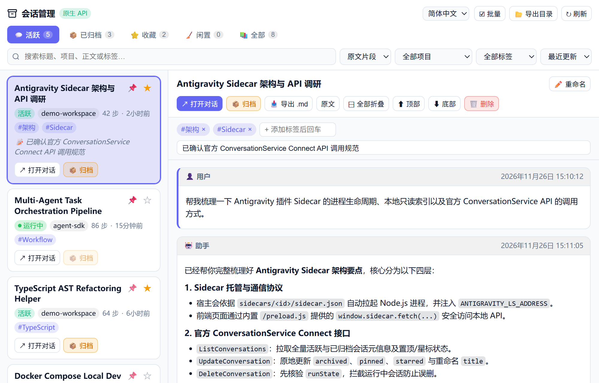
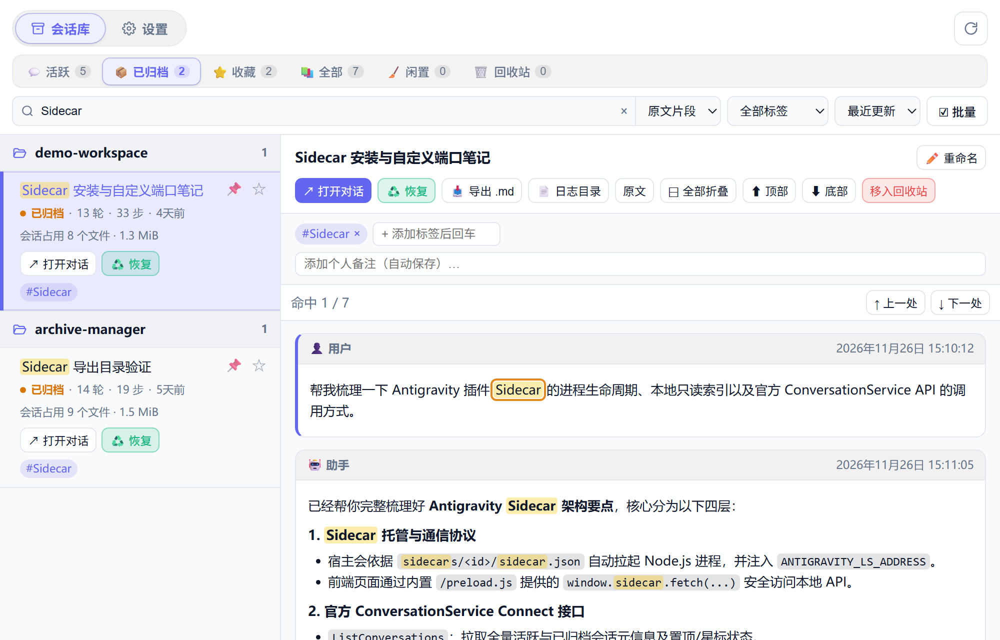

# セッション管理 · Session Manager

**Google Antigravity のセッションを検索、プレビュー、アーカイブし、Markdown に書き出せます。**

[**简体中文**](./README.md) · [**English**](./README.en.md) · [**繁體中文**](./README.zh-TW.md) · [**日本語**](./README.ja.md)

<picture>
  <source media="(prefers-color-scheme: dark)" srcset="docs/screenshots/hero-dark.png" />
  
</picture>

Google Antigravity 向けの独立したコミュニティ製プラグインです。画面は簡体字中国語、英語、繁体字中国語、日本語に対応し、選んだ言語を記憶します。セッション名、メッセージ、タグ、メモは原文のまま表示します。

## パネルの使い方

パネルを開くと、アーカイブされていないセッションが「アクティブ」に表示されます。タブは「アクティブ」「アーカイブ済み」「お気に入り」「長期未使用」「すべて」の順に並び、各タブに件数が表示されます。一覧は 1 ページにつき最大 50 セッションです。セッションを選ぶと、利用できるメッセージをすべて確認できます。

| 目的 | 操作 |
| --- | --- |
| 過去のセッションを探す | 原文の一部または複数のキーワードで検索します。プロジェクト、グループ、タグで絞り込めます。該当箇所は強調表示されます。 |
| アーカイブ・復元する | セッションカードまたはプレビュー上部から操作します。一括アーカイブや一括復元も取り消せます。 |
| まとめて完全に削除する | 「アーカイブ済み」で一括操作を開き、対象を選びます。ページをまたいで選択できます。確認画面で対象を確認し、操作後に削除、スキップ、失敗の内訳を確認できます。完全削除は取り消せません。 |
| 使っていないセッションを整理する | 未使用のセッションを 3、7、14、30 日で絞り込み、一括でアーカイブできます。実行直前に各セッションの状態を再確認します。 |
| 長い会話を読む | Markdown 表示と原文表示を切り替えられます。長いメッセージは折りたたまれ、必要な部分を展開できます。先頭と末尾への移動にも対応します。 |
| 整理して書き出す | ピン留め、スター、名前変更、タグ、メモを使えます。Markdown にはセッション情報、本文の取得元、タグ、メモが含まれます。 |



## インストールと更新

Antigravity 2.35.0 以降に対応します。Sidecar から `node:sqlite` を読み込める Node.js が必要です。Node.js 22.13 以降の 22.x LTS または 24 LTS を使用してください。

**Windows（PowerShell）**

```powershell
git clone https://github.com/YukiKaguraA/agy-archive-manager.git
cd agy-archive-manager
.\scripts\install.ps1
```

**macOS / Linux**

```bash
git clone https://github.com/YukiKaguraA/agy-archive-manager.git
cd agy-archive-manager
chmod +x scripts/install.sh
./scripts/install.sh
```

手動でインストールする場合は、`plugin.json`、`logo.svg`、4 種類の README、`CHANGELOG.md`、`LICENSE`、`docs/screenshots/`、`skills/`、`sidecars/` を `~/.gemini/config/plugins/archive-manager/` にコピーします。Windows では `%USERPROFILE%\.gemini\config\plugins\archive-manager\` です。

Antigravity の **Customizations → Plugins** で **会话管理 (Session Manager)** を有効にし、右側のプラグインメニューから開きます。言語はパネル上部で変更できます。ローカルのソースから更新するときも、同じスクリプトを実行してください。

## よくある質問

**左サイドバーにボタンが表示されません**

左サイドバーのボタンとアーカイブ件数バッジには Chrome DevTools Protocol（CDP）が必要です。使用するときは Antigravity を `--remote-debugging-port=0` で起動してください。右側のプラグインメニューからもパネルを開けます。

**パネルが開きません。SQLite のエラーが出ます**

Sidecar が使う Node.js で `node:sqlite` が利用できるか確認します。次のコマンドが `function` を出力すれば利用できます。

```sh
node -e "import('node:sqlite').then(m => console.log(typeof m.DatabaseSync))"
```

**古いセッションで一部のメッセージしか表示されません**

プレビューは `transcript_full.jsonl` を優先して読み込み、利用できる場合は `transcript.jsonl` と照合します。両方から本文を取得できない場合は、全文検索インデックスにある抜粋を表示し、会話の一部であることを知らせます。

**書き出したファイル、タグ、メモはどこにありますか**

Markdown は `~/Documents/Antigravity-Exports` に保存されます。書き出すたびに別のファイルが作られ、パネルからファイルの場所を表示できます。タグはホスト側で更新し、取得し直して反映を確認します。メモと旧版のローカルタグ情報は Sidecar のデータフォルダーに保存されます。ローカルとホストのタグが異なる場合は、プレビューで両方を確認して採用するタグを選べます。Antigravity 2.35.2 では最後のタグの削除が反映されない場合があります。その際は結果を通知し、ローカルの記録を保持します。

**Antigravity の更新後、一部の機能が動きません**

アーカイブなどの操作にはホスト内部の `ConversationService` を使います。検索は SQLite インデックスを読み取り専用で参照し、プレビューは会話ログを読み込みます。更新後の問題を報告する際は Antigravity のバージョンを添えてください。[問題を報告する](https://github.com/YukiKaguraA/agy-archive-manager/issues) · [Sidecar のドキュメント](https://antigravity.google/docs/sidecars/)

## 開発とテスト

リポジトリのルートで `node --test` を実行します。テストは模擬サービスと一時データを使用します。推奨するテスト環境は Node.js 22.15 以降の 22.x LTS または 24 LTS です。画面の変更後は `node tools/render-hero.mjs` でライトとダークのプレビューを作成できます。[履歴検索のベンチマーク](https://github.com/YukiKaguraA/agy-archive-manager/blob/v2.3.0/docs/benchmark-v2.3.0.md)

[変更履歴](./CHANGELOG.md) · [リリース](https://github.com/YukiKaguraA/agy-archive-manager/releases) · [MIT ライセンス](./LICENSE)
