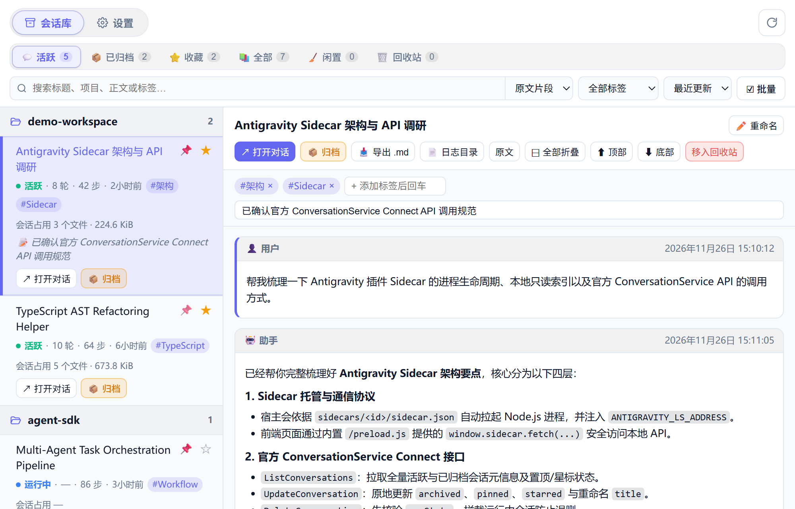
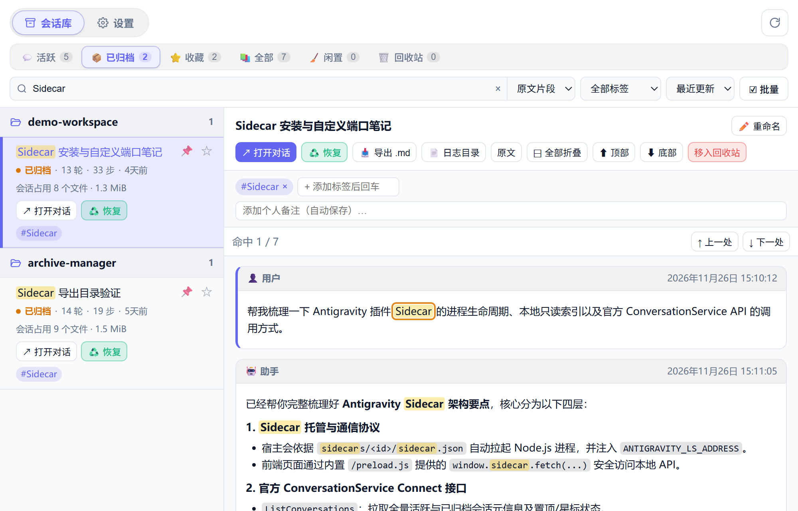

# 会话管理 (`archive-manager`)

[English](README.en.md)

适用于 Google Antigravity 的会话管理插件（Sidecar + Skill），支持浏览、归档、恢复、预览和导出会话。

## 界面预览

**主面板与超长消息自动折叠（未归档视图 · 琥珀淡黄归档按钮）**



**已归档视图、全文检索高亮与 Markdown 展开预览（绿色一键恢复）**



## 核心功能

- **多视图分类浏览**：一键切换「已归档」「未归档」「收藏」「闲置」「全部」五大视图并实时统计数量。
- **全文检索与多维筛选**：支持同时检索标题、项目名、历史消息正文（FTS 摘要索引）、自定义标签与个人备注；支持按项目、标签筛选及按最近更新 / 步数 / 标题排序。
- **原地归档与恢复（含撤回）**。点击绿色「恢复」或琥珀淡黄「归档」按钮即可切换状态。支持多选批量归档、恢复，以及按闲置天数（3 / 7 / 14 / 30 天）批量归档。
- **免恢复预览对话**
  - 优先读取 `transcript_full.jsonl`，可用时结合 `transcript.jsonl`，必要时回退到 FTS 摘要。历史数据缺失时，预览可能只包含部分消息或摘要。
  - 支持独立滚动、单条超长消息（> 450px）自动折叠并附带渐隐遮罩与「展开全文 / 收起」；
  - 预览工具栏提供「展开全部 / 全部折叠」「⬆ 顶部」「⬇ 底部」及「排版 / 原文」切换，长会话阅读跳转更顺手。
- **原生信息维护与安全删除**：支持原地重命名、卡片快捷置顶（📌）与星标收藏（★）、自定义标签（`#tag`）与自动保存个人备注（独立持久化于 Sidecar 数据目录），删除运行中会话前自动拦截并弹出二次确认。
- **一键导出 Markdown**。将可读取的对话内容连同会话信息、标签和备注保存到 `~/Documents/Antigravity-Exports`，支持定位文件或打开导出目录。
- **左侧导航栏快捷入口（可选）**。启用 CDP 后，左侧栏显示「会话管理」入口与已归档数量。右侧面板插件菜单和对话技能也可打开面板。

## v2.1.1 更新

- 修复快速切换会话或筛选条件时，较晚返回的旧请求覆盖当前预览或列表的问题。
- 批量归档与恢复支持撤回已成功变更的会话。部分操作失败时，面板会显示处理结果。
- 批量归档闲置会话时，后端按当前会话状态重新判断资格，跳过已归档、已收藏、已置顶、正在运行或尚未达到闲置天数的会话。
- 无法确认会话已停止时，阻止永久删除。标签和备注采用原子保存，读取异常时保留原文件。
- Markdown 导出记录内容来源，并在适用时标注警告。每次导出生成独立文件。
- 仅在发现可用的调试页面后读取左栏归档计数。归档状态变更后刷新角标。

## 安装方法

### 方式一：使用安装脚本（推荐）

**Windows (PowerShell)：**

```powershell
git clone https://github.com/YukiKaguraA/agy-archive-manager.git
cd agy-archive-manager
.\scripts\install.ps1
```

**macOS / Linux：**

```bash
git clone https://github.com/YukiKaguraA/agy-archive-manager.git
cd agy-archive-manager
chmod +x scripts/install.sh
./scripts/install.sh
```

### 方式二：手动安装

将本仓库中的以下核心文件复制到 Antigravity 插件目录 `~/.gemini/config/plugins/archive-manager/`（Windows 为 `%USERPROFILE%\.gemini\config\plugins\archive-manager\`）：

- `plugin.json`
- `logo.svg`
- `README.md`
- `LICENSE`
- `skills/`
- `sidecars/`

安装完成后，在 Antigravity 的 **Customizations → Plugins** 中启用 **会话管理 (Session Manager)**，即可在右侧辅助面板或通过对话指令「打开会话管理面板」唤醒。

## 目录结构

```text
agy-archive-manager/
├── plugin.json                         # 插件清单与元信息
├── agy-market.json                     # AGY Market 市场伴随配置
├── logo.svg                            # 插件图标
├── README.md                           # 中文说明文档
├── README.en.md                        # 英文说明文档
├── LICENSE                             # MIT 开源协议
├── docs/
│   └── screenshots/                    # 界面预览截图
├── scripts/
│   ├── install.ps1                     # Windows 一键安装 / 更新脚本
│   └── install.sh                      # macOS / Linux 一键安装 / 更新脚本
├── skills/
│   └── archive-manager/
│       └── SKILL.md                    # 对话唤醒技能定义
├── sidecars/
│   └── archive_manager/
│       ├── sidecar.json                # Sidecar 进程与面板入口配置
│       ├── server.mjs                  # 本地 HTTP + ConversationService 后端
│       ├── sidebar_injector.mjs        # 左侧栏快捷入口注入器（可选 CDP）
│       └── index.html                  # 前端双栏管理面板
└── test/                               # 本地回归测试套件
```

## 运行要求

- **Google Antigravity**。设计目标为 Antigravity 2.35.0。面板和进程生命周期使用公开的 Sidecar 机制。参见 [Antigravity Sidecar 文档](https://antigravity.google/docs/sidecars/)。
- **会话数据**。归档等操作通过内部 `ConversationService` 提交，搜索和预览读取内部 SQLite 摘要索引和转录文件，其中 SQLite 以只读方式打开。Antigravity 更新可能改变这些接口和数据格式。
- **Node.js**。本插件的 Sidecar 启动命令是 `node`，要求 Antigravity 实际启动的 Node.js 默认启用 `node:sqlite`，例如 Node.js 22.13+（22.x LTS 分支）或 Node.js 24 LTS。详见 [Node.js SQLite 文档](https://nodejs.org/api/sqlite.html)。
- **左侧栏快捷入口（可选）**。入口和归档角标依赖 Antigravity 的界面结构和 Chrome DevTools Protocol（CDP），使用时以 `--remote-debugging-port=0` 启动 Antigravity。

## 本地回归测试

测试使用 Node.js 22.15+（22.x LTS 分支）或 Node.js 24 LTS。在仓库根目录运行以下命令。

```sh
node --test
```

测试仅使用模拟的 Antigravity 服务和临时会话数据。

## 开源协议

本项目基于 [MIT License](LICENSE) 开源。
