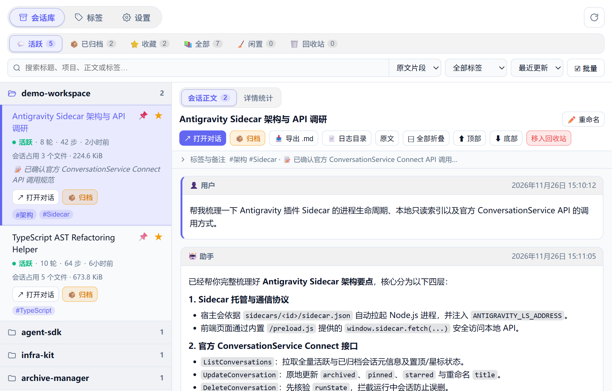
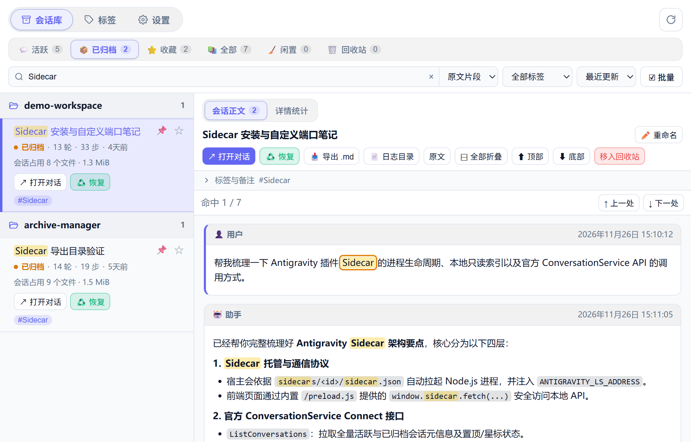

# 會話管理 · Session Manager

**在 Google Antigravity 中搜尋、預覽、封存及匯出會話。**

[**简体中文**](./README.md) · [**English**](./README.en.md) · [**繁體中文**](./README.zh-TW.md) · [**日本語**](./README.ja.md)

<picture>
  <source media="(prefers-color-scheme: dark)" srcset="docs/screenshots/hero-dark.png" />
  
</picture>

這是獨立社群外掛。Google Antigravity 用於說明相容性。面板支援簡體中文、English、繁體中文和日本語，並會記住所選語言。會話標題、訊息、標籤及備註依原文顯示。

## 使用方式

從頂端切換「會話庫」、「標籤」與「設定」。「會話庫」包含活躍、已封存、收藏、全部、閒置和資源回收筒。開啟面板時預設進入「活躍」並展開最近更新的工作區，每個工作區每次最多載入 50 個會話。卡片顯示使用者輪次、步數、檔案數量與占用空間。

| 要做的事 | 操作 |
| --- | --- |
| 找到舊會話 | 在搜尋框右側選擇「原文片段」或「多關鍵字」，搭配工作區清單、原生群組或標籤篩選。搜尋命中處會反白。 |
| 封存與還原 | 使用會話卡片或預覽工具列。批次封存、批次還原和閒置清理均可復原。 |
| 使用資源回收筒 | 移入資源回收筒時先封存。還原時會回到原本的封存狀態，也可在資源回收筒內確認永久刪除。預設保留七天，可在設定選擇 1–365 天。縮短保留期會顯示到期數量，清理由例行檢查或手動確認觸發。 |
| 清理閒置會話 | 在「閒置」選擇 3、7、14 或 30 天。執行時會重新確認會話狀態。 |
| 閱讀長會話 | 預覽可切換排版與原文。長訊息會自動摺疊，按 `F3` 或 `Shift+F3` 可跳到下一處或上一處搜尋結果。 |
| 複製訊息或整輪對話 | 對訊息卡片按右鍵，選擇「複製本則全文」或「複製本輪對話」。已摺疊的訊息也會完整複製。 |
| 查看詳細統計 | 切換到「詳細統計」查看輪次、工具呼叫、檔案變更與可用的 Token 數量。 |
| 管理標籤 | 在「標籤」新增、搜尋、篩選、重新命名、合併或移除標籤。也可在預覽的「標籤與備註」加入既有標籤。 |
| 自訂角色名稱 | 在「設定 → 訊息卡片角色名稱」預覽並儲存使用者與助理名稱，訊息卡片與 Markdown 匯出會同步使用。留空即可採用目前語言的預設名稱。 |
| 整理與匯出 | 將會話置頂、收藏、重新命名或加入標籤與備註。匯出 Markdown 會附上會話資訊、內容來源、標籤及備註。 |



工作區優先採用宿主專案順序，未歸屬會話排在最後。在預覽使用 `F3` 或 `Shift+F3` 可循環跳轉並展開命中的摺疊訊息，也可開啟原始記錄資料夾。

預覽的「詳細統計」可查看輪次、工具呼叫及記錄中的檔案變更，並定位仍存在的檔案。Token 優先使用本機 Usage Monitor 帳本，其次使用會話記錄的實際數值。

標籤依會話狀態計數。若本機與宿主標籤不同，批次操作會略過該會話。對已選取的文字或訊息中的連結按右鍵，可使用宿主選單。

## 🆕 v2.4.0

- 工作區可展開或收合，資源回收筒支援還原，偏好設定集中在同一頁。
- 新增標籤目錄與會話詳細統計。有 Usage Monitor 資料時可查看增強統計。
- 可自訂訊息角色名稱，並從卡片右鍵複製訊息全文或配對的整輪對話。

[完整更新日誌](./CHANGELOG.md)

## 安裝或更新

適用於 Antigravity 2.35.0 以上。Sidecar 需要可直接匯入 `node:sqlite` 的 Node.js，建議使用 22.13 以上的 22.x LTS 或 24 LTS。

**Windows（PowerShell）**

```powershell
git clone https://github.com/YukiKaguraA/agy-archive-manager.git
cd agy-archive-manager
.\scripts\install.ps1
```

**macOS / Linux**

```bash
git clone https://github.com/YukiKaguraA/agy-archive-manager.git
cd agy-archive-manager
chmod +x scripts/install.sh
./scripts/install.sh
```

如要手動安裝，將 `plugin.json`、`logo.svg`、四份 README、`CHANGELOG.md`、`LICENSE`、`docs/screenshots/`、`skills/` 與 `sidecars/` 複製到 `~/.gemini/config/plugins/archive-manager/`。Windows 位置為 `%USERPROFILE%\.gemini\config\plugins\archive-manager\`。

在 Antigravity 的 **Customizations → Plugins** 啟用 **会话管理 (Session Manager)**，再從右側外掛選單開啟。可在面板的「設定」切換語言，也可在對話中請助理開啟會話管理面板。從本機原始碼更新時，重新執行同一個安裝指令即可。

## 常見問題

**左側欄沒有快捷入口**

左側欄入口與封存計數徽章使用 Chrome DevTools Protocol（CDP）。若需要此入口，請使用 `--remote-debugging-port=0` 啟動 Antigravity。也可以從右側外掛選單開啟面板。

**面板無法開啟，或出現 SQLite 錯誤**

確認用來啟動 Sidecar 的 Node.js 可載入 `node:sqlite`。以下指令應輸出 `function`。

```sh
node -e "import('node:sqlite').then(m => console.log(typeof m.DatabaseSync))"
```

**部分舊會話只能看到摘要**

預覽優先使用 `transcript_full.jsonl`，可用時會結合 `transcript.jsonl`。兩者皆無法提供內容時，面板改用全文索引摘要並提示內容可能不完整。

**匯出檔案、標籤與備註放在哪裡**

Markdown 預設匯出到 `~/Documents/Antigravity-Exports`，可在設定選取資料夾或輸入絕對路徑，每次匯出會建立一個檔案。可在面板中定位檔案。標籤透過宿主服務更新並讀回確認。本機備註及舊版的標籤覆寫資料存於 Sidecar 資料目錄。若舊標籤和宿主標籤不同，可在預覽中查看兩者並選擇要採用的版本。Antigravity 2.35.2 可能忽略清空最後一個標籤的要求，外掛會核對結果並保留本機資料。

**更新 Antigravity 後功能異常**

封存使用宿主的 `ConversationService`。搜尋及預覽以唯讀方式查詢 SQLite 索引，並讀取會話轉錄。若更新後發生問題，請附上 Antigravity 版本回報。[回報問題](https://github.com/YukiKaguraA/agy-archive-manager/issues) · [Sidecar 文件](https://antigravity.google/docs/sidecars/)

## 開發與驗證

在儲存庫根目錄執行 `node --test`，測試使用模擬服務與暫存會話。以 Node.js 22.15 以上的 22.x LTS 或 24 LTS 執行測試。更新介面後，使用 `node tools/render-hero.mjs` 產生亮色和暗色主圖。[歷史會話效能基準](https://github.com/YukiKaguraA/agy-archive-manager/blob/v2.3.0/docs/benchmark-v2.3.0.md)

[更新日誌](./CHANGELOG.md) · [版本發布](https://github.com/YukiKaguraA/agy-archive-manager/releases) · [MIT 授權](./LICENSE)
